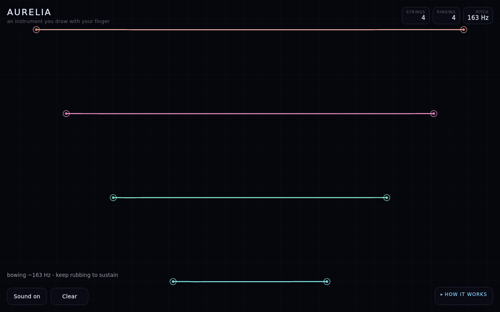
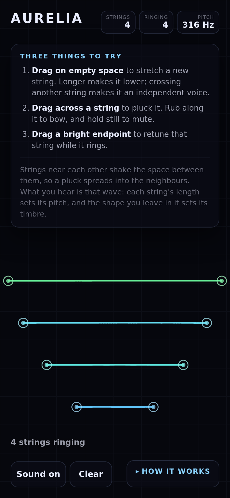
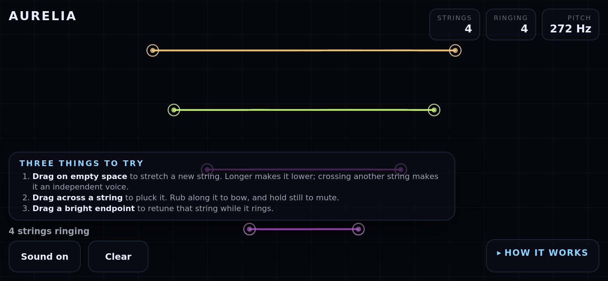

# Aurelia

[](https://github.com/thaumapolis/aurelia/actions/workflows/check.yml) **[▶ Play it live](https://rawcdn.githack.com/thaumapolis/aurelia/d4efe20408ea84363ebd3745ca7a2156706823cc/index.html)**

An instrument you draw with your finger. Every line you stretch across the screen becomes a real wave simulation - a thread pinned at both ends, integrated in real time - and the shape you leave in it is the sound you hear.

**[Open `index.html`](index.html)** in any modern browser. It is a single self-contained file with no network access, no build step, and no storage, so it also works inside a sandboxed `iframe` and offline from a local copy.



## What you are looking at

The canvas is a field of strings. Each one vibrates according to a wave equation, so a pluck travels out to the pinned ends, reflects, and interferes with itself; that interference is what you hear as a pitch. Three numbers in the corner tell you what the instrument is doing: how many strings exist, how many are still ringing, and the pitch of the one you last touched.

There is nothing to configure. The app explains itself on screen and gets out of the way:

- **Drag on empty space** to stretch a new string. Longer makes it lower - halve the length and the pitch rises an octave, and the readout counts it as it happens.
- **Drag across a string** to pluck it. Rub along its length to bow it and hold it sustained; press and hold still to mute it.
- **Drag a bright endpoint** to retune that string while it rings.

The three verbs are listed in a panel on first load. It disappears once you make your first string, because after that the status line - `bowing ~163 Hz - keep rubbing to sustain`, `retuning 183 Hz -> 188 Hz` - is more useful than instructions. `HOW IT WORKS` in the corner holds the longer explanation, including why nearby strings drift in and out of phase.

## Controls

| Input | Result |
| --- | --- |
| Drag on empty space | New string; length sets the pitch |
| Drag across a string | Pluck |
| Rub along a string | Bow, sustained while you keep moving |
| Hold still on a string | Mute it |
| Drag an endpoint | Retune while it rings |
| `C` / `Z` / `M` / `D` | Clear, undo, mute, reset the demo instrument |
| `Sound on` / `Clear` | Toggle audio, empty the canvas |

Sound starts on your first touch, because browsers require a user gesture before any audio may play.

The layout is computed, not fixed, and it is tested at three viewports. On a phone in portrait the seeded instrument sits below the instruction panel rather than behind it; in landscape the panel collapses to the three verbs and keeps its own strip clear of the status line. The bottom row - `Sound on`, `Clear`, `HOW IT WORKS` - is checked for overlap at 360, 390 and 430px, because those controls are anchored to opposite corners with nothing between them, and a label that grows by a few pixels is enough to draw one control through another.




## Running it

Open `index.html`. That is all - there is no server and no install. To edit it, change the files in `src/` and rebuild the artifact:

```sh
node tools/build.mjs          # writes index.html from src/
```

`src/` is split into the wave simulation (`sim.js`), the audio graph (`audio.js`), the app and layout (`app.js`), and the boot wiring (`boot.js`); `tools/build-lib.mjs` inlines them into one file and refuses to emit a bundle with a duplicate top-level binding.

Serving it is optional, and `serve.py` is there for the times a URL is wanted instead of a file - a phone on the same network, or a preview pane that cannot open a `file://` path:

```sh
./serve.py                    # http://127.0.0.1:8000/
PORT=8123 ./serve.py          # a port you choose
```

It sets `text/html` and `Cache-Control: no-store`, because a phone that keeps a preview pane's old copy is a confusing way to discover the instrument has changed. It takes its bind address from `HOST`/`PASEO_PORT` when a Paseo daemon allocates the port, then `PORT`, then `127.0.0.1:8000`.

### Live, from the repo

**<https://rawcdn.githack.com/thaumapolis/aurelia/d4efe20408ea84363ebd3745ca7a2156706823cc/index.html>** runs the instrument straight out of this repository - no build, no hosting, nothing to install. That works only because the page is one file that asks for nothing else, font included, so there is no second request for a proxy to get wrong. That it is really this file is worth checking rather than taking on faith:

```sh
curl -s https://rawcdn.githack.com/thaumapolis/aurelia/d4efe20408ea84363ebd3745ca7a2156706823cc/index.html | sha256sum
sha256sum index.html          # same digest
```

The link is pinned to a commit rather than to `main` so it cannot drift under the README. It must name **the commit that last changed `index.html`**, not `HEAD` - HEAD can never contain a pin naming itself, so that version of the rule cannot be satisfied and passes only while the README is uncommitted. `check.sh` phase 6 enforces the real rule and fails when the artifact changes under a stale pin, so the obligation cannot be quietly forgotten. `raw.githack.com/thaumapolis/aurelia/main/index.html` is the moving form and needs no maintenance at all; both serve the same bytes.

Two things to expect. rawgithack puts a one-time **External Content Notice** in front of any HTML it proxies, with an *Open the page* button, so the instrument is behind that click. And it caches, so a fresh push takes a moment to appear on the `main` form - a check shortly after pushing served a pre-font `index.html` for about a minute while the pinned-SHA form was already correct. It is somebody else's server, so treat it as a demo path; the file in this repository is the artifact.

`raw.githubusercontent.com` will not work, and not for the usual reason: GitHub serves it as `text/plain` with a sandboxing content-security-policy, and a browser runs no script from it at all. Stripping that is precisely what rawgithack exists to do.

### The font is embedded, and that is not optional

The artifact ships its own font: DejaVu Sans Regular and Bold, subset to the characters the page can draw, base64-encoded as WOFF2 inside the stylesheet (~21 KiB). It asks for that face by one family name, `"Aurelia Sans"`, and never consults the host.

This is a correctness requirement, not a preference. The sheet used to ask for `ui-sans-serif, system-ui, "Segoe UI", Roboto, "DejaVu Sans", sans-serif` - a font the project does not control. CI's Firefox and the developer shell resolved that stack to different faces, glyph advances drifted, every line of text fell out of alignment, and all 18 golden screenshots failed at 0.6-4.5% while looking identical to the eye. Embedding also keeps the offline promise honest: a font resolved through fontconfig is an external dependency.

Both weights are embedded because the sheet asks for 550-700. Shipping only Regular would make the browser synthesise a fake bold whose stem weight varies per engine, which is the same cross-machine drift wearing a different hat. This is visible in the screenshots: the button labels and the `4 strings ringing` status are now set in a real bold.

Regenerate the subsets with `./tools/with-fonttools.sh`, which takes `pyftsubset` and `woff2_compress` from the pinned nixpkgs. It is the only part of the project that wants network, and the output is committed so that building and testing need neither network nor font tooling. `tests/build.test.mjs` fails if the faces go missing, if a weight is dropped, or if the stylesheet reaches for a system stack again.

## Checks

The toolchain is pinned in `flake.nix` and `flake.lock` - Node, Playwright and its browsers - so a fresh machine and CI resolve exactly the same versions and no golden image can be repainted by a nixpkgs bump. Either form works:

```sh
nix develop --command ./check.sh      # flake-native
nix-shell shell.nix --run ./check.sh  # same shell, pre-flake entry point
```

`check.sh` runs six phases and treats any phase it cannot run as a failure rather than a skip, because a script that prints `ALL CHECKS PASSED` after painting nothing is worse than one that errors:

1. **Build** the artifact, so tests never run against a stale `index.html`.
2. **Syntax** - parse every source, tool and test file.
3. **53 unit and interaction tests** - the wave physics, the gestures (pluck versus bow versus mute, retuning, undo, cancelled pointers, multi-touch), and the artifact's own promises: no network, no storage, and a font it owns.
4. **Engine coverage** - boot and play the instrument in Firefox and Chromium, asserting the strings are visible and no page error or network request occurs. This is behavioural, not pixel-based: a second engine differs in font rasterisation, so comparing it to the Firefox baselines would fail for reasons unrelated to the app. Narrow the list with `./check.sh --engines firefox` where an engine cannot start at all.
5. **18 golden screenshots** - three viewports by six states, compared against committed baselines.
6. **Published preview link** - the README's pinned commit must be the one that last changed `index.html`, and must hold these exact bytes.

The goldens are deterministic: a `?quiet=1` parameter hands the clock to the harness so frame *N* means the same thing on every run, and every scene reproduces at 0.000% difference. Regenerate them with:

```sh
node tests/golden.test.mjs --update     # after looking at every new baseline
```

### Which browser the screenshots use

`DEFAULT_ENGINE` is **Firefox**. The goldens are captured and compared inside one process, so a baseline can only ever be checked by the engine that drew it, and the committed set is Firefox.

`--engine chromium` and `--engine webkit` are available and fail loudly if the browser cannot start, rather than falling back to Firefox and reporting that they tested something they did not. **The committed baselines are expected to differ under another engine**, in anti-aliasing rather than layout - the font is now embedded, so the glyphs themselves are identical everywhere.

Some sandboxes cannot start Chromium at all: on the development machine used for this project it dies before painting (SIGTRAP at `sandbox_host_linux.cc:41`, and crashpad `setsockopt: Operation not permitted`) even with `--no-sandbox`, and WebKit aborts at `Failed to adopt IPC::Connection socket`. That is a property of the sandbox, not of the app - CI runs Chromium with no such trouble - and `--engines firefox` narrows the local run to match. Firefox happens to need none of the syscalls the others want.

## CI

`.github/workflows/check.yml` runs the same `./check.sh` in the same pinned shell, so CI is not a second definition of correct. It runs on pushes and pull requests to `main`, with `--engine firefox --engines firefox,chromium` named explicitly rather than left to defaults.

CI is where Chromium is actually verified: the app boots there, seeds the instrument, and a scripted drag creates a string, in both engines. Pixel comparison stays on Firefox, for the reason above. On failure the job uploads the frames CI saw under `golden-actual`, which is the difference between "the layout moved" and "the font changed".

## Known limits

- Strings you draw go exactly where you draw them, including under the buttons; the layout rules only place the seeded instrument.
- The goldens are pixel-compared on Firefox only; Chromium is verified behaviourally, in CI. Rendering Chromium goldens would need its own committed baselines.
- Sound needs a browser gesture, so the first interaction is silent by design.
